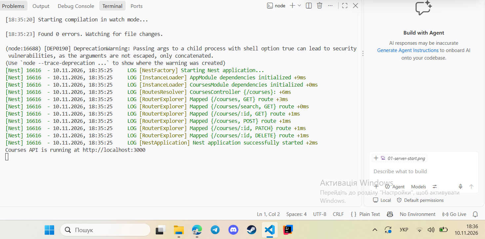
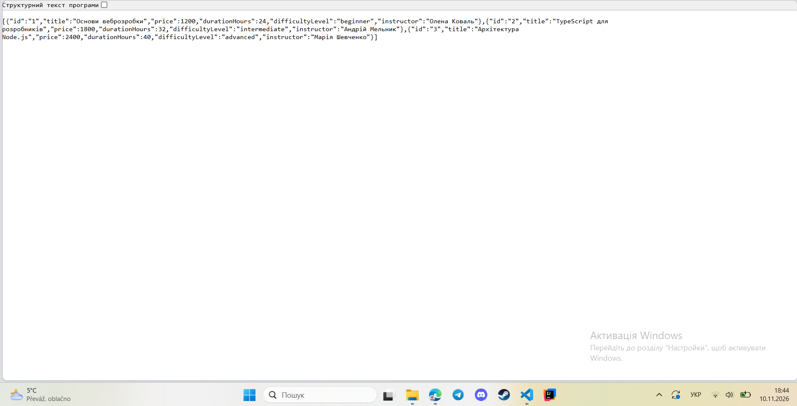
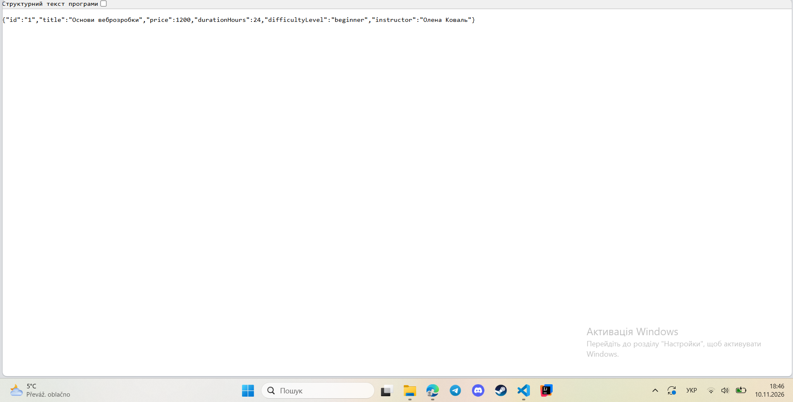
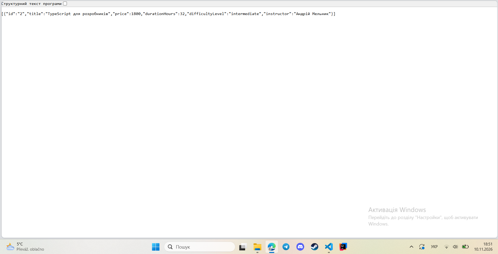
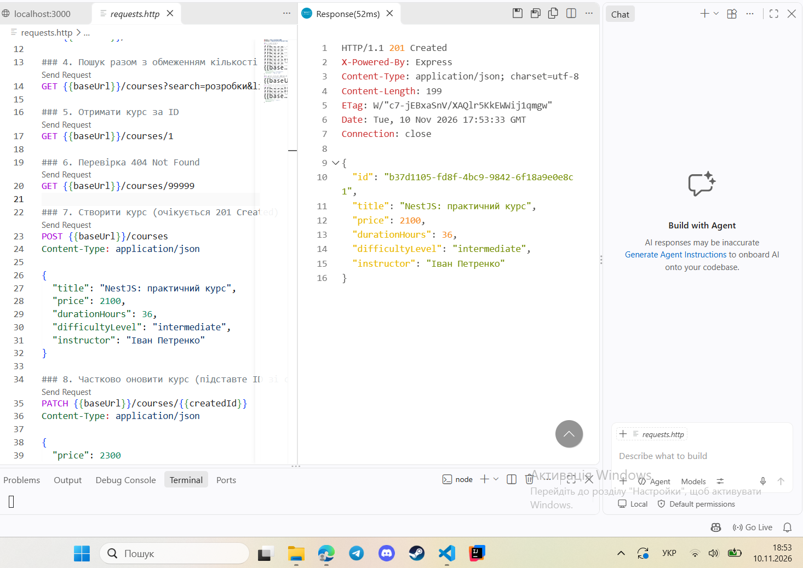
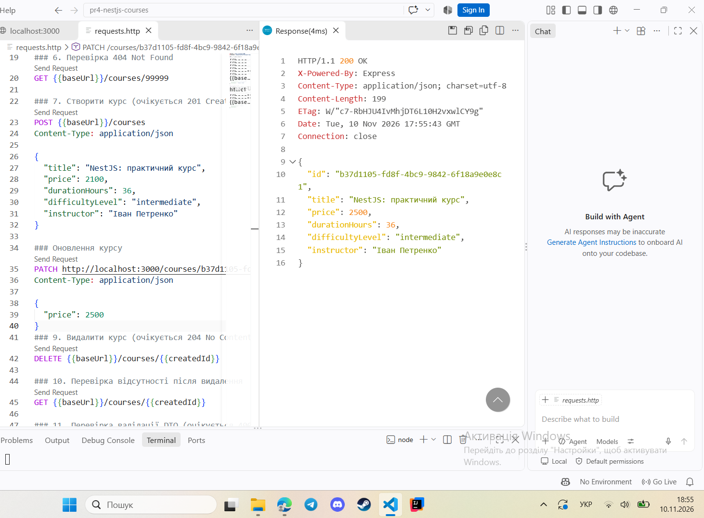
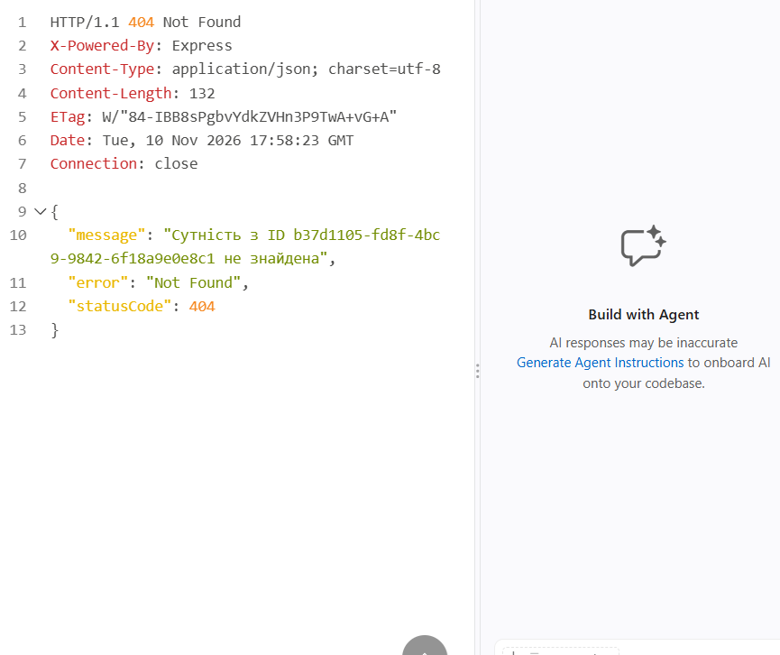
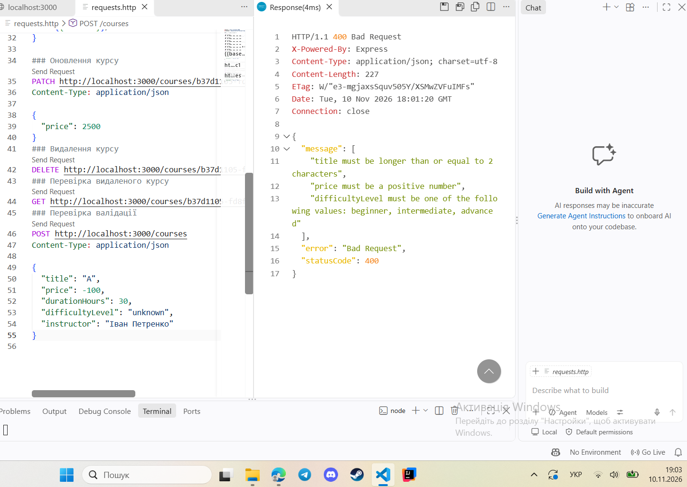
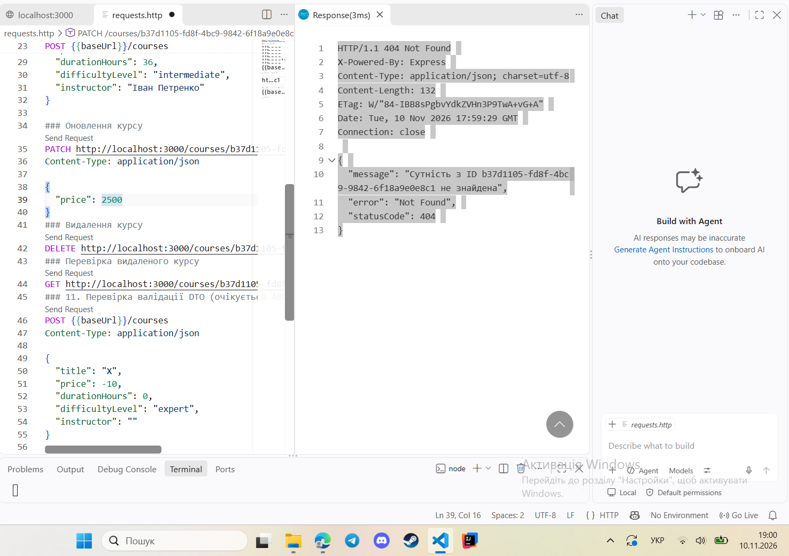

# Практична робота №4 — Розроблення REST API на NestJS

**Варіант №9 — Онлайн-курси та підписки**

Базовий маршрут API: `/courses`

---

## 1. Мета роботи

Ознайомитися з принципами розроблення REST API за допомогою фреймворку NestJS, навчитися створювати HTTP-ендпоінти, реалізовувати CRUD-операції, використовувати DTO для перевірки вхідних даних та обробляти HTTP-помилки.

## 2. Опис предметної області

У межах практичної роботи розроблено REST API для керування онлайн-курсами.

Кожен курс містить такі поля:

| Поле | Тип | Опис |
|---|---|---|
| `id` | string | Унікальний ідентифікатор курсу |
| `title` | string | Назва курсу |
| `price` | number | Вартість курсу |
| `durationHours` | number | Тривалість курсу в годинах |
| `difficultyLevel` | string | Рівень складності |
| `instructor` | string | Ім'я викладача |

Для поля `difficultyLevel` передбачено три допустимі значення:

- `beginner` — початковий рівень;
- `intermediate` — середній рівень;
- `advanced` — просунутий рівень.

## 3. Використані технології

У процесі розроблення використано:

- **NestJS** — серверний фреймворк для створення REST API;
- **TypeScript** — мова програмування;
- **Node.js** — середовище виконання;
- **class-validator** — бібліотека для валідації даних;
- **class-transformer** — перетворення вхідних даних;
- **REST Client** — розширення Visual Studio Code для тестування HTTP-запитів;
- **Git та GitHub** — система контролю версій і розміщення проєкту.

## 4. Структура проєкту

```text
pr4-nestjs-courses/
│
├── src/
│   ├── courses/
│   │   ├── dto/
│   │   │   ├── create-course.dto.ts
│   │   │   └── update-course.dto.ts
│   │   │
│   │   ├── entities/
│   │   │   └── course.entity.ts
│   │   │
│   │   ├── courses.controller.ts
│   │   ├── courses.service.ts
│   │   └── courses.module.ts
│   │
│   ├── app.module.ts
│   └── main.ts
│
├── docs/
│   └── screenshots/
│       ├── 01-server-start.png
│       ├── 02-get-courses.png
│       ├── 03-get-course-by-id.png
│       ├── 04-search-courses.png
│       ├── 05-create-course.png
│       ├── 06-update-course.png
│       ├── 07-delete-course.png
│       ├── 08-validation.png
│       └── 09-not-found.png
│
├── requests.http
├── package.json
├── nest-cli.json
├── tsconfig.json
├── README.md
├── REPORT.md
└── .gitignore
```

## 5. Реалізація проєкту

Проєкт має модульну архітектуру NestJS.

**AppModule** — головний модуль застосунку, який підключає модуль курсів.

**CoursesModule** — модуль, що об'єднує контролер і сервіс для роботи з курсами.

**CoursesController** — відповідає за обробку HTTP-запитів і маршрутизацію.

**CoursesService** — реалізує основну логіку роботи з курсами: отримання, пошук, створення, оновлення та видалення.

**CreateCourseDto** — визначає правила перевірки даних під час створення курсу.

**UpdateCourseDto** — забезпечує можливість часткового оновлення курсу за допомогою `PartialType`.

Для створення унікальних ідентифікаторів використовується `randomUUID()`.

Дані зберігаються у внутрішньому масиві сервісу. Початково додано три тестові курси.

> Важливо: у цій реалізації база даних не використовується. Усі зміни зберігаються в оперативній пам'яті та скидаються до початкового стану після перезапуску сервера.

## 6. Встановлення та запуск

Для роботи з проєктом необхідно встановити Node.js версії 18 або новішої та npm.

### Клонування репозиторію

```bash
git clone https://github.com/nikitachalovka/pr4-nestjs-courses.git
```

Перехід до папки проєкту:

```bash
cd pr4-nestjs-courses
```

### Встановлення залежностей

```bash
npm install
```

### Запуск сервера

```bash
npm run start:dev
```

Після успішного запуску сервер доступний за адресою:

```text
http://localhost:3000
```

Основний маршрут API:

```text
http://localhost:3000/courses
```

### Перевірка збірки

```bash
npm run build
```

Для перевірки використовується команда `npm run build`. Збірка проєкту виконана успішно.

## 7. Реалізовані REST-ендпоінти

У проєкті реалізовано такі HTTP-маршрути:

| Метод | Маршрут | Призначення | Статус |
|---|---|---|---|
| GET | `/courses` | Отримання всіх курсів | 200 |
| GET | `/courses?search=TypeScript` | Пошук за назвою | 200 |
| GET | `/courses?limit=2` | Обмеження кількості результатів | 200 |
| GET | `/courses/search?q=TypeScript` | Пошук через окремий маршрут | 200 |
| GET | `/courses/:id` | Отримання курсу за ID | 200 |
| POST | `/courses` | Створення нового курсу | 201 |
| PATCH | `/courses/:id` | Часткове оновлення курсу | 200 |
| DELETE | `/courses/:id` | Видалення курсу | 204 |

Для пошуку використовується параметр `search`, який дозволяє знаходити курси за назвою без урахування регістру символів.

Параметр `limit` обмежує кількість повернених записів.

Для маршруту `GET /courses` також налаштовано HTTP-заголовки:

- `X-API-Version: 1.0`
- `X-Service-Status: operational`

## 8. Валідація вхідних даних

Для перевірки даних використовується бібліотека `class-validator`.

У класі `CreateCourseDto` реалізовано такі правила:

| Декоратор | Призначення |
|---|---|
| `IsString()` | Перевірка, що значення є рядком |
| `MinLength(2)` | Мінімальна довжина тексту — два символи |
| `IsNumber()` | Перевірка числового значення |
| `IsPositive()` | Перевірка додатного значення |
| `IsIn()` | Перевірка допустимого рівня складності |

У файлі `main.ts` налаштовано глобальний `ValidationPipe` з параметрами:

- `whitelist: true`;
- `transform: true`;
- `forbidNonWhitelisted: true`.

Це забезпечує перевірку вхідних даних, перетворення типів і відхилення невідомих полів.

Якщо надіслані дані не відповідають правилам валідації, сервер повертає `400 Bad Request`.

## 9. Обробка помилок

Для обробки помилок використовується механізм винятків NestJS.

У випадку звернення до курсу з неіснуючим ідентифікатором сервіс генерує `NotFoundException`.

Основні HTTP-статуси:

| Статус | Назва | Призначення |
|---|---|---|
| 200 | OK | Запит виконано успішно |
| 201 | Created | Курс успішно створено |
| 204 | No Content | Курс успішно видалено |
| 400 | Bad Request | Некоректні вхідні дані |
| 404 | Not Found | Курс не знайдено |

## 10. Тестування REST API

Для тестування використано файл `requests.http` у Visual Studio Code з розширенням REST Client.

Усі основні сценарії перевірено під час локального запуску сервера.

### 10.1. Запуск сервера

Після запуску команди `npm run start:dev` NestJS успішно скомпілював проєкт і зареєстрував необхідні маршрути.

**Скріншот 1 — Успішний запуск сервера**



### 10.2. Отримання всіх курсів

Запит:

```http
GET http://localhost:3000/courses
```

Очікуваний та отриманий результат: `200 OK`. Сервер повертає список початкових курсів у форматі JSON.

**Скріншот 2 — Отримання всіх курсів**



### 10.3. Отримання курсу за ID

Запит:

```http
GET http://localhost:3000/courses/1
```

Результат: `200 OK`. Отримано інформацію про курс із відповідним ідентифікатором.

**Скріншот 3 — Отримання курсу за ID**



### 10.4. Пошук курсів

Запит:

```http
GET http://localhost:3000/courses?search=TypeScript
```

Результат: `200 OK`. Сервер повернув курс «TypeScript для розробників».

**Скріншот 4 — Пошук курсів**



### 10.5. Створення нового курсу

Запит:

```http
POST http://localhost:3000/courses
Content-Type: application/json

{
  "title": "NestJS: практичний курс",
  "price": 2100,
  "durationHours": 36,
  "difficultyLevel": "intermediate",
  "instructor": "Іван Петренко"
}
```

Результат: `201 Created`.

Новий курс успішно створено. Сервер автоматично присвоїв йому унікальний UUID.

**Скріншот 5 — Створення нового курсу**



### 10.6. Оновлення курсу

Для оновлення використано ID, отриманий після виконання POST-запиту.

Запит:

```http
PATCH http://localhost:3000/courses/ID_СТВОРЕНОГО_КУРСУ
Content-Type: application/json

{
  "price": 2500
}
```

Результат: `200 OK`.

Ціну курсу успішно змінено з 2100 на 2500. Інші поля залишилися без змін.

**Скріншот 6 — Оновлення курсу**



### 10.7. Видалення курсу

Запит:

```http
DELETE http://localhost:3000/courses/ID_СТВОРЕНОГО_КУРСУ
```

Результат: `204 No Content`.

Курс успішно видалено з масиву даних.

**Скріншот 7 — Видалення курсу**



### 10.8. Перевірка валідації

Для перевірки було надіслано некоректні дані: назву довжиною в один символ, від'ємну ціну та недопустимий рівень складності.

Результат: `400 Bad Request`.

Сервер відхилив запит і повернув повідомлення про помилки валідації.

**Скріншот 8 — Перевірка валідації**



### 10.9. Перевірка помилки 404

Після видалення курсу було виконано GET-запит із тим самим ідентифікатором.

Результат: `404 Not Found`.

Сервер підтвердив, що курс із таким ID більше не існує.

**Скріншот 9 — Обробка помилки 404**



## 11. Результати виконання роботи

Під час тестування було перевірено такі операції:

| № | Операція | Отриманий статус | Результат |
|---|---|---|---|
| 1 | Отримання списку курсів | 200 OK | Успішно |
| 2 | Пошук за назвою | 200 OK | Успішно |
| 3 | Отримання курсу за ID | 200 OK | Успішно |
| 4 | Створення нового курсу | 201 Created | Успішно |
| 5 | Оновлення курсу | 200 OK | Успішно |
| 6 | Видалення курсу | 204 No Content | Успішно |
| 7 | Перевірка неіснуючого ID | 404 Not Found | Успішно |
| 8 | Перевірка некоректних даних | 400 Bad Request | Успішно |

## 12. Висновок

У результаті виконання практичної роботи №4 було розроблено REST API для керування онлайн-курсами засобами NestJS.

Під час роботи реалізовано модульну структуру застосунку, контролер і сервіс для роботи з курсами, CRUD-операції, пошук і фільтрацію даних, DTO для валідації вхідних параметрів та обробку HTTP-помилок.

Було проведено тестування основних ендпоінтів за допомогою REST Client. Успішно перевірено створення, отримання, оновлення та видалення курсів, а також механізми валідації й обробки помилок.

Поставленої мети досягнуто. Отримано практичні навички створення REST API, роботи з NestJS, TypeScript та тестування серверних застосунків.

---

## 13. Посилання на GitHub

Репозиторій проєкту:

**[https://github.com/nikitachalovka/pr4-nestjs-courses](https://github.com/nikitachalovka/pr4-nestjs-courses)**

**Практична робота №4 — Варіант №9 — Онлайн-курси та підписки.**